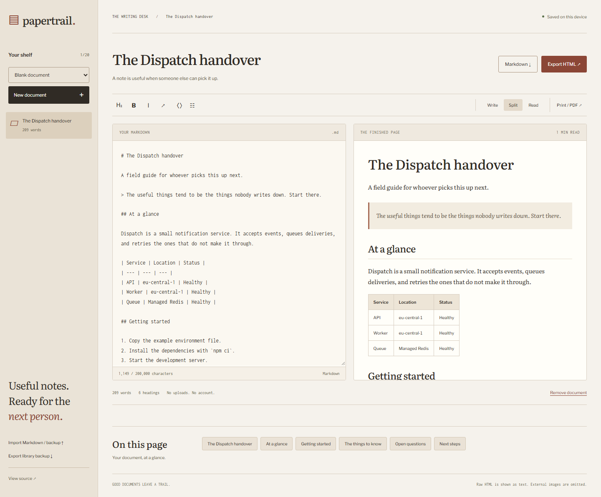

# Papertrail

Turn the notes in your head into something the next person can use. A local Markdown desk for technical handovers, release notes, and decision records, with readable exports that work outside the editor.

[Open the writing desk](https://goshkaaaa.github.io/papertrail/) · [Mobile screenshot](docs/mobile.png)



## What makes it useful

- Start from a technical handover, release note, decision record, or blank document.
- Write Markdown beside a live document preview, or switch to write/read mode.
- Navigate a generated outline, including repeated and non-English headings.
- Insert heading, emphasis, code, link, and list syntax around selected text.
- Keep up to 20 named drafts in this browser, with automatic saving.
- Import Markdown files and library backups as new copies; existing drafts are kept.
- Remove a document and undo the most recent removal.
- Download Markdown, a library backup, or a standalone HTML document with embedded styles and no JavaScript dependency.
- Print the preview or save as PDF using the browser print dialog, with editor controls excluded.

The Dispatch handover is sample content, not a real service runbook. The shelf and drafts stay on this device. Export a backup for anything you want to retain or move to another browser.

## Run locally

Use Node.js 24 LTS.

```sh
npm ci
npm run dev
```

Open the URL printed by Vite.

```sh
npm run lint
npm run check
npm test
npx playwright install chromium
npm run test:e2e
npm run build
npm run preview
```

Vite builds to `dist/`. GitHub Pages builds set the base path to `/papertrail/`. The current demo is a verified static build on a separate `gh-pages` branch. Verify and Deploy demo workflows are included for accounts with GitHub Actions available. Switch the Pages source to GitHub Actions to enable automatic deployments.

## Inside

Svelte 5 runes, JavaScript, Vite, markdown-it, DOMPurify, and plain CSS. No server, account, or API key.

`src/markdown.js` renders tokens, assigns collision-resistant heading IDs, and derives the outline. `src/storage.js` validates and serializes a versioned document library. `src/export.js` creates portable HTML with its own stylesheet and a restrictive content security policy. The component sanitizes rendered markup before both preview and export.

Unit tests cover Markdown features, HTML escaping, dangerous links, omitted images, heading IDs, filename handling, standalone HTML, and library validation. Desktop and mobile browser tests cover live editing, persistence, templates, removal/undo, imports, downloaded content, script/image handling, print layout, and initial-screen accessibility.

## Deliberate boundaries

Raw HTML in Markdown is displayed as text. External images are replaced by an omission label, so previewing a note does not load remote image URLs. Tables, fenced code, blockquotes, lists, and standard Markdown links are supported. There are no remote plugins or embedded scripts. Code blocks are rendered as text without syntax highlighting. Clicked links still navigate to their destinations.

Each draft allows 200,000 characters. Library import files are limited to 5 MB and 20 documents. Imports create fresh IDs rather than overwriting existing drafts. Browser storage quotas can still be lower than the maximum library size; a failed save is reported, and exports remain available. Use one writing tab at a time; there is no cross-tab conflict resolution or cloud sync.

Word count is an approximate whitespace-based count of Markdown source. Reading time assumes 220 words per minute. PDF pagination depends on your browser and print settings. Optional Google Fonts have local fallbacks; exported HTML uses local fonts and needs no network connection.

MIT license.
